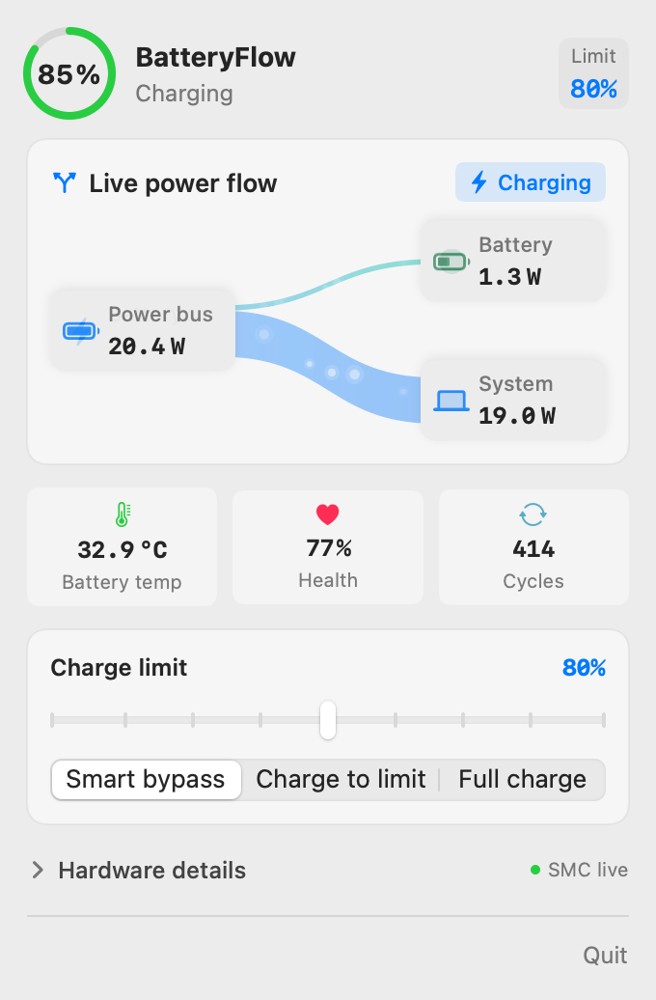
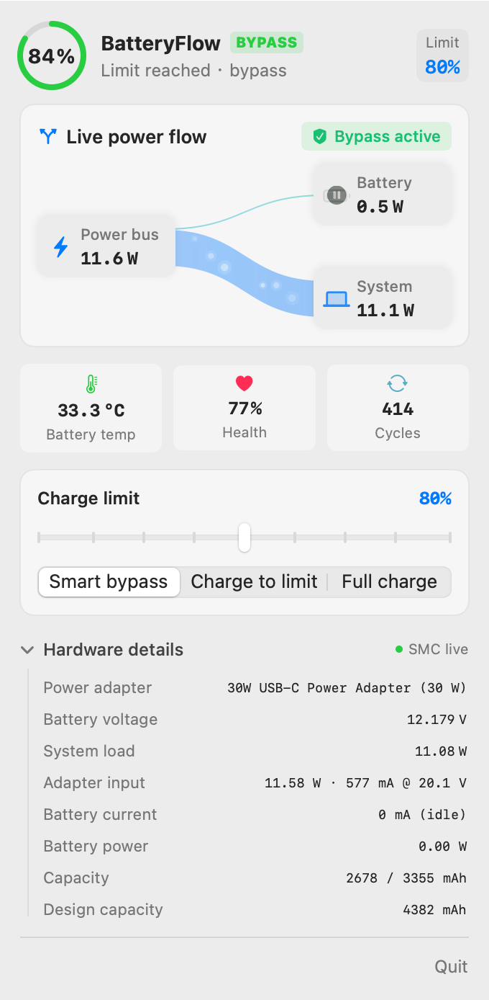

# BatteryFlow

A lightweight macOS menu bar battery monitor and charge limiter. Native SwiftUI, about 0.3% CPU while idle, 1s SMC sampling, paused on lock/sleep.

---

> [Download the latest release](https://github.com/dday55/BatteryFlow/releases/latest) · [Official Website](https://dday55.github.io/BatteryFlow/)

## Screenshots

| Main panel | Hardware details |
| :---: | :---: |
|  |  |

---

## Features

- **Power flow Sankey**: live `Power bus → Battery / System` view covering charging, bypass, battery assist and limit discharge.
- **Second-level telemetry**: current, voltage, power and temperature read directly from AppleSMC; IOPS events for plug and battery state. Missing values show as `—`.
- **Menu bar only**: LSUIElement, no Dock icon, click the battery item to open the panel.
- **Charge limiting**: supports the new macOS SMC path (`bfF0` / `bfD0` / `bfE0`). The app ships a minimal privileged helper and asks for admin approval once on first launch.
- **Hardware details**: voltage, current, power, temperature, capacity, cycle count and health.
- **Bilingual UI**: follows the system language (Chinese / English); restart the app after changing the system language.

---

## Quick Start

```bash
# Build
./build.sh

# Run
open BatteryFlow.app

# Install and add to Login Items
cp -R BatteryFlow.app /Applications/
```

Requirements: macOS with Xcode Command Line Tools (`swiftc`, `clang`, IOKit).

---

## Charge Limiting

Recent macOS firmware removed `CH0B` / `CH0C` / `CHTE`. The new registers are `bfF0` (mode), `bfD0` (upper limit) and `bfE0` (lower limit); writing them requires root.

- On first launch, the app asks for admin approval and installs the helper from its own bundle to `/usr/local/libexec/batteryflow-smc`, with a minimal sudoers rule.
- The helper only writes these three SMC keys and accepts only `status`, `reset` and `golden-gate`.
- If the target is below the current charge, the battery discharges to the limit. Once reached, it stays in the window and recharges when below the lower bound.
- Before uninstalling, restore charging and remove the helper:

```bash
sudo /usr/local/libexec/batteryflow-smc reset
sudo rm -f /usr/local/libexec/batteryflow-smc /etc/sudoers.d/batteryflow
```

---

## Data Freshness

- **SMC**: current, voltage, power and temperature, sampled every second.
- **IOPS / AppleSmartBattery**: battery percentage and plug state, updated about every 60 seconds; used as fallback when SMC keys are unavailable.
- The `SMC live / System snapshot` indicator next to the panel title shows the current data source.

---

## License

[MIT](LICENSE)
